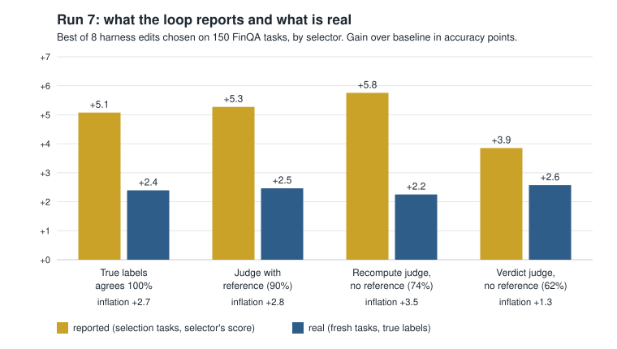

# Selection curse: how much of a self-improvement loop's reported gain is real?

A self-improvement loop proposes edits to an agent's harness (its prompt, rules and
settings), scores each edit on some tasks, and keeps the best. The score it reports for the
kept edit is measured on the same tasks it used to choose. This repository measures how far
that reported number sits above the edit's real gain, and whether using an LLM judge
instead of true labels makes it worse or teaches the loop to game the judge.

Seven runs, small local models, pre-registered where stated, nulls reported.

## Headline (run 7, pre-registered)



Setting: a 7B student answers questions about financial report pages (FinQA dev). 40
hand-written single edits to its harness, each run on 300 fresh tasks. The loop is replayed
offline: draw 8 candidate edits, pick the best on 150 tasks, then measure that edit on the
other 150 with true labels. 3000 replays per selector.

| Selector | Agrees with truth | Reported | Real | Winner's curse | Multiplier vs truth | Formula |
|---|---|---|---|---|---|---|
| True labels | 100% | +5.1 | +2.4 | +2.7 | 1.00 | 1.00 |
| LLM judge shown the reference answer | 90% | +5.3 | +2.5 | +2.8 | 1.06 | 1.07 |
| LLM judge, no reference, recomputes the answer | 74% | +5.8 | +2.3 | +3.6 | 1.36 | 1.37 |
| LLM judge, no reference, verdict only (approves 88%) | 62% | +3.9 | +2.6 | +1.7 | 0.64 | 0.87 |

Gains are accuracy points over the baseline harness. "Winner's curse" is the part of the
reported gain that disappears on fresh tasks under the same selector. Reported minus real
equals the curse plus the judge's persistent bias, which is why the last row's gap in the
figure (+1.3) is smaller than its curse (+1.7): that judge's bias on the winner was -0.4.

What this shows:

1. **The loop reports about twice its real gain even with perfect labels.** +5.1 reported,
   +2.4 real. No judge is needed for a self-improvement number to be inflated.
2. **A reference-free judge adds a modest extra curse, and the pre-registered test of it was
   inconclusive.** The multiplier was 1.36 with a 95% interval of 1.06 to 1.82. The
   prediction needed the lower bound above 1.15 to pass and at or below 1.0 to fail.
3. **A one-line formula predicts the multiplier.** It is the square root of the ratio of the
   selector's residual variance to that of true labels: 1.37 predicted, 1.36 observed.
4. **The curse follows the judge's variance, not its accuracy.** The verdict-only judge agrees
   with truth least, yet has the smallest curse, because it approves nearly everything and
   its scores barely move (interval for its multiplier: 0.49 to 1.08). A bad judge can look
   like a stable one.
5. **No reward hacking.** The kept edit carried no more judge bias than a randomly picked one
   (+0.7 points, interval -0.8 to +2.1). Selection concentrated noise, not judge-pleasing.
6. **The judge picked edits as good as true labels did.** Real gain was +2.3 under the judge
   and +2.4 under labels. Only the reported number was more inflated.

Caveats that apply to every number above: FinQA is a public 2021 dataset and may be in the
student's pretraining data. One domain, one student model, one judge model, and a
hand-written set of 40 edits; the interval treats that set as fixed. Run 6, the exploratory
run that motivated this one, suggested a multiplier of 1.6 to 1.7; it shrank on fresh data.

Design: [RUN7_DESIGN.md](RUN7_DESIGN.md). Predictions, committed before the run:
[PREDICTION_run7.md](PREDICTION_run7.md). Numbers: `runs_v7/analyze.json`.

### Run 7 predictions

| | Prediction | Result | Verdict |
|---|---|---|---|
| H1 (primary) | Recompute-judge multiplier 1.3 to 2.0, interval lower bound above 1.15; fails at or below 1.0 | 1.36, interval 1.06 to 1.82 | Inconclusive |
| H2 | Multiplier within 25% of the variance formula | 1.36 against 1.37 | Holds |
| H3 | Winner's judge bias within 1.5 points of a random pick's, interval includes 0 | +0.7, interval -0.8 to +2.1 | Holds |
| H4 | Judge with reference: multiplier 0.6 to 1.25 | 1.06 | Holds |
| H5 | Verdict judge has a smaller multiplier than the recompute judge | 0.64 against 1.36 | Holds |
| H6 | Judge-selected winner has real gain at or below zero | +2.3 points | Fails |

H1's interval and H4's range were changed after a power check on run 6 data and before
registration; the file lists both changes and why. H6 failed because run 7's edits had real
headroom (32 of 40 raised truth), which run 6 had not found on 150 tasks.

## The formula

For a loop that keeps the best of k candidates scored on m tasks:

    curse ≈ c_k * sqrt(r / m)

- `c_k` is the expected maximum of k standard normals (about 1.42 for k = 8).
- `r` is the residual variance of the selector's per-task gain, after removing each edit's
  mean and each task's mean.
- For true labels `r` comes from the student alone. A judge adds its own per-task error, so
  `r` grows and the curse grows by `sqrt(r_judge / r_truth)`.

The approximation is exact when the candidates do not differ in real quality and is an
upper bound when they do, since some of the selection then lands on real differences (run 7:
3.1 points predicted for true labels, 2.7 observed). The ratio between two selectors is
what the formula predicts well.

The curse is an absolute number of points set by k, m and noise. It does not depend on how
large the real improvement is. A loop with large real gains can ignore it; a loop polishing
the last few points cannot. The practical rule is the same with labels or a judge: re-score
the kept edit on tasks that played no part in choosing it.

`rsi/goodhart.py` estimates the variance components; `rsi/replay.py` and `rsi/run7.py`
replay selection over a stored bank of edits without calling a model.

## All runs

Held-out results first. Spider 1.0, BIRD and FinQA are public and likely in the models'
pretraining data, which limits every absolute number here.

| Run | Setting | Status | Result |
|---|---|---|---|
| 1 to 3 | Single-shot text-to-SQL, 1.5B student, LLM proposer | Exploratory | Tuning-set gains did not transfer to held-out databases. About half of run 1's tuning-set passes were false positives under Spider's test suites. |
| 4 | Same, six seeds, random-edit control | Pre-registered | Null primary: regularized loop against plain loop on held-out Spider, -4.3 tasks of 322, p = 0.56. Random edits matched the LLM proposer. |
| 5 | Multi-step SQL agent, 7B student, 32B proposer, six seeds | Pre-registered | Gains transferred: about +12 points on held-out Spider in 6 of 6 seeds. Random edits gained as much as the LLM proposer (difference -1.3 tasks, p = 0.53). Most gains came from one missing default (showing the schema). No measurable selection gap. Three of four predictions were wrong. |
| 6 | FinQA agent, LLM judges as label-free selectors, 150 tasks | Exploratory | Looked for reward hacking: a loop that learns to please the judge. Did not find it. Found that selection concentrates noise, and that the first judge prompt was near chance against truth (AUROC 0.55) until checked. |
| 7 | Same as 6, 300 fresh tasks | Pre-registered | The table above. |

Two things run 5 and run 7 do not agree on, stated plainly: run 5 measured no gap between
tuning-set gain and fresh-task gain, and run 7 measured a 2.7-point curse under true labels.
The settings differ (edit size, keep rule, tasks per decision, six seeds against a replay),
and nothing here tests which difference matters.

- Runs 1 to 5 in full: [docs/RUNS_1_TO_5.md](docs/RUNS_1_TO_5.md)
- Run 6: [RUN6_DESIGN.md](RUN6_DESIGN.md)
- Blog-length account: [docs/BLOG_DRAFT.md](docs/BLOG_DRAFT.md)

## What this does not show

- **That loops cannot learn to game a judge.** The edits here were written by hand. An LLM
  proposer told to raise the judge's approval is implemented (`rsi/fin_propose.py`) and has
  not been run.
- **Anything about large models or other domains.** One 7B student, one 8B judge, FinQA.
- **A confirmed judge effect.** The primary prediction was inconclusive.
- **How much repeated judging helps.** Asked again about the same 3,900 episodes at
  temperature 0, the recompute judge changed its verdict on 11.8% of them. Averaging repeats
  should reduce its curse; that was not measured.

## Reproduce

```bash
pip install -r requirements.txt
python -m pytest -q
```

The tests use scripted models and synthetic data; they need no GPU, API key or dataset.
(`tests/test_components.py::test_load_spider_hardness` fails on Windows on a path separator.)

Summaries and logs are committed under `runs*/`. The per-episode transcripts and grades for
runs 6 and 7 (about 1.2 GB) are not, so re-deriving `analyze.json` means re-running the
models. For run 7 that is about 9 hours on one A10 GPU:

```bash
# FinQA dev split (github.com/czyssrs/FinQA, dataset/dev.json) goes in data/finqa/dev.json
# Ollama 0.40.13 serving on port 11435 with qwen2.5:7b-instruct and llama3.1:8b
python -m rsi.bank build --frozen frozen_v7.yaml --workers 8
python -m rsi.run7 verdict --workers 8
python -m rsi.run7 repeat --workers 8
python -m rsi.run7 analyze
python figures/make_run7_figure.py
```

GPU batching is not bit-reproducible, so individual answers will differ slightly from the
committed run.

## Layout

| Path | What |
|---|---|
| `rsi/domains/finqa.py` | FinQA agent with `calc` and `submit` tools, programmatic grading |
| `rsi/proxies.py` | The LLM judges (with reference, recompute, verdict) |
| `rsi/fin_edits.py` | The 40-edit catalog: placebo, style, substance, structural, targeted |
| `rsi/bank.py`, `rsi/stage0.py` | Run every edit on every task and cache episodes and grades |
| `rsi/goodhart.py` | Variance decomposition of proxy gain into real, bias and noise |
| `rsi/replay.py`, `rsi/run7.py` | Offline selection replay, bootstrap, the registered analysis |
| `rsi/fin_propose.py` | LLM edit proposer, including a red-team variant (not run) |
| `rsi/` (other files), `scripts/` | The text-to-SQL loop of runs 1 to 5 |
| `PREDICTION*.md` | Predictions, each committed before its run |
| `frozen*.yaml` | Frozen configuration per run |
| `cloud/` | GPU launch tool with spend caps, and the ledger of every instance |

## Provenance and license

This repository was extracted from the `rsi_pilot/` directory of
[Chiron](https://github.com/RohanChavan0701/Chiron), where the runs were done. Commit dates
are the original ones; hashes differ because author metadata was normalized during
extraction. The run 7 predictions were committed at 09:24 UTC on 2026-11-10 and the GPU
instance was launched at 09:48 UTC (Chiron commit `1bddf6d`; here "run 7: register
predictions"). Paths written as `rsi_pilot/...` in older documents refer to this
repository's root. `harness/evaluator.py` is copied unchanged from Chiron.

Related work this builds on: the winner's curse in LLM self-improvement loops under
true-metric selection (arXiv 2610.09239), regularized recursive self-improvement of agent
harnesses (arXiv 2609.24972), and random-search baselines for such loops (arXiv 2602.16805).
`RUN6_DESIGN.md` has the fuller list.

**License.** MIT (see `LICENSE`), except `third_party/spider_eval/`, which is vendored from
taoyds/test-suite-sql-eval under Apache 2.0 with its LICENSE. FinQA, Spider and BIRD data
are not included and carry their own terms.
