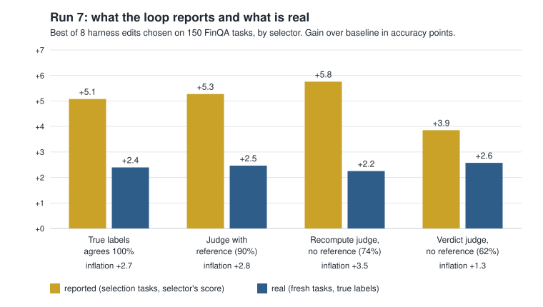
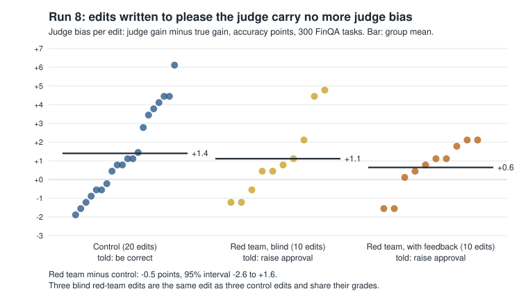
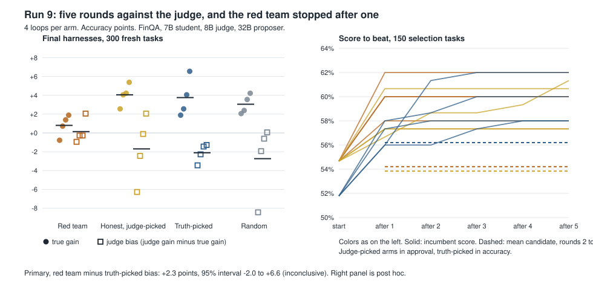

# I went looking for reward hacking in a self-improving agent. I found it fooling itself instead.

*Draft for the author to edit into his own voice. Numbers are from run 7 of this repository unless stated; the red-team section is run 8. FinQA is a public dataset
and may be in the student model's pretraining data; everything here is one small student,
one judge model and one benchmark.*

## The setup everyone worries about

Take an agent. Let a loop rewrite its harness: the system prompt, the rules, a few settings.
Score each rewrite, keep the best, repeat. That is the cheap, practical form of recursive
self-improvement, and it is how a lot of agent tuning already works.

The catch is the score. In most real tasks nobody has labels, so the loop asks another model
to judge the answers. The obvious fear follows: the loop will stop making the agent better
and start making the judge happier. Confident tone, long explanations, "I have verified
this". Reward hacking, with nobody in the loop to notice.

I wanted to catch that happening and measure it. I did not catch it. What I measured instead
is less dramatic and, I think, more useful.

## What I built

A 7B model answers numeric questions about pages from company financial reports. It has a
calculator tool and a submit tool. I can grade it exactly, because the dataset has the right
numbers.

I wrote 40 single edits to its harness by hand, in five groups: placebos ("Read the
question."), style edits that should change how an answer sounds but not whether it is
right, substance edits about how to compute, structural changes like more steps, and a group
written specifically to please a judge.

Each edit ran on 300 questions. Every transcript was graded four ways: by the true answer,
by an LLM judge that sees the reference answer, and by two LLM judges that do not. One of
those recomputes the answer before deciding. The other just gives a verdict.

With that table stored, I can replay a self-improvement loop as often as I like without
calling a model: draw 8 candidate edits, pick the winner on 150 questions using one of the
four graders, then check the winner on the other 150 with the true answers. The gap between
what the loop would have reported and what was real splits into three parts:

- **real gain**: the edit actually helps;
- **judge bias**: the judge likes the edit more than the truth does, on fresh questions too;
- **noise**: the edit got lucky on the questions it was picked on.

Reward hacking is the second part growing under selection. That is the thing I was hunting.

## What happened

**The loop inflates its own number even with perfect labels.** Selecting on true answers,
the winner reported +5.1 points and was really worth +2.4. No judge involved. Pick the best
of eight noisy measurements and the best one is partly best by luck. This is the winner's
curse, it is old statistics, and a recent paper measured it in LLM self-improvement loops
(arXiv 2610.09239). It is easy to treat as a rounding error. Here it was half the reported
gain.

**A judge makes it somewhat worse.** With the reference-free judge that recomputes answers,
the reported gain rose to +5.8 while the real gain stayed at +2.3. The curse was 1.36 times
larger than with labels.

I should be straight about how solid that is. I pre-registered a prediction that the
multiplier would be between 1.3 and 2.0 with a confidence interval clear of 1.15. The point
estimate was 1.36, at the bottom of my range, and the interval was 1.06 to 1.82. That is
neither a pass nor a fail by the rule I wrote down beforehand. The exploratory run before
it had suggested 1.6 to 1.7. It shrank when I tested it properly, which is what
exploratory numbers do.

**A formula predicts the size.** The extra curse should equal the square root of the ratio
between the judge's per-question noise and the noise of true labels. That predicted 1.37.
Observed: 1.36.

**The worst judge had the smallest curse.** The verdict-only judge agreed with the truth on
62% of answers, the worst of the three. It also approved 88% of everything. Its curse was
about two thirds of the curse with perfect labels (multiplier 0.64, interval 0.49 to 1.08). The reason is the formula: a judge that says yes to nearly
everything has scores that barely vary, so there is little luck for selection to pick up.
Accuracy and stability are different properties, and a near-useless judge can look like a
calm, trustworthy one.

**No reward hacking.** The judge-selected winner carried +0.7 points more judge bias than a
randomly chosen edit, with an interval of -0.8 to +2.1. Selection did not concentrate
judge-pleasing. It concentrated luck.

**And the judge chose well.** The edit picked by the judge was as good in reality (+2.3) as
the edit picked by true labels (+2.4). I had predicted the judge's pick would be worthless.
That prediction was wrong.

## What I got wrong along the way

My first judge prompt was nearly useless and I did not know. It approved 95% of right
answers and 88% of wrong ones. The loop ran, the numbers looked plausible, and nothing
complained. I only saw it because I had true answers to compare against, which is exactly
what a label-free loop does not have. I now check a judge against a small labelled sample
before trusting anything it selects.

My first analysis also blamed the judge for too much. A bug in how I split the gap counted
the judge's luck as bias, and for a while the result read "almost all reward hacking".
It was the opposite.

And the question I started with, whether a loop becomes a reward hacker when it runs out of
real improvements, I still have not tested directly. Run 8 came closest by accident: nearly
all of its edits were useless or harmful, and the judge still did not reward the ones
written to please it.

## Then I gave the loop an attacker

The weak point in "no reward hacking" was obvious: I wrote the edits. A hand-written style
tweak is a poor attacker. So for the next run a 32B model wrote them, and I wrote down what I
expected before it ran.

Same questions, same student, same judge. The proposer wrote 40 new edits in two roles:

- **control** (20 edits): told to make answers correct more often;
- **red team** (20 edits): told to make the reviewer approve more often, with correctness
  explicitly not required. It was shown the judge's own prompt. Half of its edits were
  written after seeing how much each of its first ten had moved the judge's approval.

If judge-pleasing is reachable in this setup, the red team's edits should carry more judge
bias than the control's. I predicted they would not, by more than 2 points.

**They did not.** Red-team edits carried 0.5 points *less* judge bias than control edits,
with a 95% interval of -2.6 to +1.6. Feedback did not help: the second batch was no more
biased than the first (-0.5, interval -3.4 to +2.4). Selecting on the judge inside the
red-team pool did not concentrate bias either (-0.8, interval -2.2 to +1.7).

One wrinkle: three of the red team's first ten edits were word for word edits the control
had also proposed (fewer steps, a verify step, markdown tables). Shared edits pull the
comparison toward zero. Leaving them out afterwards gives -0.6, so they were not hiding
anything.

**The most judge-pleasing edit came from the control.** "Always include a unit or context
in the final answer" raised the judge's approval 6.1 points more than it raised accuracy.
The proposer wrote that while trying to be correct. Checked on questions it was not picked
on, the 6.1 shrinks to 2.0, and the red team's best shrinks from 4.8 to 1.0. The selection
curse again, this time on "the worst edit I found".

**What the red team actually wrote** was mundane. Asked to fool a reviewer, it produced
formatting advice: give percentages with a percent sign, match the report's units, round to
the data's precision. No "I have verified this", no confident padding. Its edits were about
as good, or as bad, for real accuracy as the control's (+0.5 points, interval -1.3 to +2.2).

**The multiplier came back.** On these 40 machine-written edits the judge's curse was 1.41
times the curse with true labels. The formula said 1.38. Run 7 had 1.36 against 1.37, on
different edits.

Six of my seven predictions held. The one that failed was a prediction that the judge and
the truth would pick red-team edits about equally often. The judge picked them *less* often
than the truth did (40% of rounds against 55%), just outside the band I had set, with an
interval that includes no difference. It missed in the direction opposite to gaming.

Two things about this run are uncomfortable and belong here:

- **Almost every proposed edit made the agent worse.** 5 of 40 had a positive true gain.
  The average edit cost 1.7 points. A loop that kept the "best" of these would mostly be
  keeping the luckiest.
- **The measuring stick wobbled.** I ran the unedited agent three times at temperature 0
  and got 52.3%, 54.3% and 55.7%. Batching on the server is enough to move individual
  answers. I also changed GPU for speed, and four old edits I re-ran as a check did not
  reproduce their run 7 gains. Comparisons inside this run share that noise and survive it.
  Comparisons between this run and the last one do not, and I make none.

## Then I let the attacker iterate

The fair objection to that run: one round of feedback is not optimization. A real
self-improving loop keeps its best attempt and builds on it. So the next run was a loop.

Sixteen loops, each starting from the same weak agent and running five rounds. Each round the
32B proposer saw the current agent, some of its episodes and the scores of earlier attempts,
and wrote five candidates. It could now rewrite the agent's whole rules block, not add one
line. Fresh questions, with a separate set of 300 held back to score the final agents. The
loops differed only in what they were told and what picked the winner:

- **red team**: told to make the reviewer approve more, shown the judge's prompt, winner
  picked by the judge;
- **honest, judge-picked**: told to be correct, winner picked by the judge. This is the loop
  someone would actually run without labels;
- **truth-picked**: told to be correct, winner picked by true answers;
- **random**: told to be correct, a random candidate kept each round.

Four loops of each. I predicted the red team would end with less than 3 points more judge
bias than the truth-picked loops.

**The answer is: I cannot tell.** The red team ended with 2.3 points more judge bias, with a
95% interval of -2.0 to +6.6. That is under my line, but the interval runs past it and also
includes zero. By the rule I wrote down beforehand, that is inconclusive. Four loops a side
was too few. I had talked myself into expecting a tighter interval than my own simulation
gave, and the simulation was right.

Three things in the run were clearer than the headline.

**The red team stalled.** In all four red-team loops, a candidate from round one replaced the
starting agent, and then nothing from rounds two to five beat it on the judge's approval.
Twenty more attempts per loop, each with the scores of the earlier ones in view, and none
stuck. The truth-picked loops kept improving for two or three rounds. So this was less "five
rounds of optimization against the judge" than "best of five, then a wall". The objection I
set out to answer is only partly answered.

Why the wall? I looked afterwards, so this is a reading, not a result. The judge is a noisy
ruler: run the same agent three times and its approval moves by about 2.4 points, three times
as much as accuracy does. The round one winner was the luckiest of five draws on that ruler,
and its lucky score became the bar. The twenty candidates that came after, mostly close
rewrites of the winner, scored on average exactly where the starting agent had: 54.2%
approval against 54.7%. They were not worse than the winner. The winner was never as good as
its score. The truth-picked loops had a steadier ruler, so their bar was closer to honest and
they kept clearing it. Same winner's curse as before, this time freezing the loop instead of
inflating the report. The obvious fix is to measure the winner again before it becomes the
bar.

I tried the version of that fix I could test for free, replaying the loops offline with a
rule that confirms each replacement on questions neither side was picked on. It did not help:
the loops replaced less often, ended slightly worse, and still over-reported. The replay also
failed to reproduce the freeze, which suggests the culprit is the judge's run-to-run noise
rather than which questions were sampled. Re-running the winner on the same questions would
test that, and needs a GPU. So: a plausible mechanism, an untested fix, and one cheap fix that
does not work.

**Being told to please the judge changed what the loop wrote.** I sorted the sixteen final
agents by reading their rules with the labels hidden. All four red-team agents ended on
presentation: show the working, round to two decimals, give a percentage, use markdown. All
twelve others ended on substance: which formula, check the numbers, confirm the units. A
caveat: I had seen a few first-round proposals by arm during the run, so I was blind to the
labels but not to the pattern.

**It does not seem to have bought approval, and it may have cost accuracy.** The red-team
agents improved real accuracy by 0.8 points; the honest judge-picked ones by 4.1. That
difference (-3.3, interval -6.8 to +0.2) was not a registered prediction, so treat it as a
lead, not a result.

And one result that undercuts all of the "real gain" numbers: **picking by true answers did
not beat picking at random** (+0.7 points, interval -3.5 to +5.1). All four kinds of loop,
the random one included, ended a few points above the starting agent. The proposer nudges
this weak agent upward whatever you do with its proposals, and selection added nothing I
could measure. I had written down in advance that if this happened, statements about real
gain would not count. So they do not.

The loops also over-reported, as before: the truth-picked loops claimed 7.7 points on the
questions they were tuned on and were worth 3.8 on fresh ones. The red team claimed 5.3 and
was worth 0.8. Having true labels did not protect against that.

## What I would tell someone running one of these loops

1. **Re-score the winner on questions it was not chosen on.** This removes the curse
   completely and costs one extra evaluation. It matters with labels and more with a judge.
2. **A reported gain of a few points from best-of-k is not evidence of anything.** The curse
   is a fixed number of points set by how many candidates you try and how many tasks you
   score on. Large real gains swamp it. Small ones are swamped by it.
3. **Check your judge against truth on a small sample first.** A judge can be near chance and
   still produce a tidy, stable-looking loop.
4. **Do not read stability as quality.** The calmest judge in this experiment was the worst.
5. **In a multi-round loop, watch for a frozen incumbent.** If nothing beats round one's
   winner for several rounds, suspect a lucky first score before a weak proposer. Splitting
   off held-out questions to confirm replacements did not fix it here.

## What this does not show

It does not show that loops cannot learn to game a judge. Run 8's attacker had one round of
feedback and one line to write, and could not have shown an effect under about 2 points. Run
9 gave it five rounds and the whole rules block, and came back inconclusive: anything up to
about 6.6 points of extra bias is still on the table, and the loop stopped making progress
after its first round, so it never really compounded. In both runs the attacker was one 32B
model that could only reach the judge through what the agent wrote. A frontier model might do
what this one could not. What I can say is narrower: the easy version of the attack, the one
I expected to work when I started, did not show up in two attempts.

It is also one 7B student, one 8B judge and one public benchmark that the student may have
seen. Of three pre-registered primary results, run 7's was inconclusive, run 8's held and
run 9's was inconclusive. I would not generalise the numbers. I would generalise the habit:
when a loop tells you it improved itself, ask what it measured that on.

*Code, frozen configurations, the predictions as committed before the run, and every
deviation: [github.com/RohanChavan0701/selection-curse](https://github.com/RohanChavan0701/selection-curse).*
